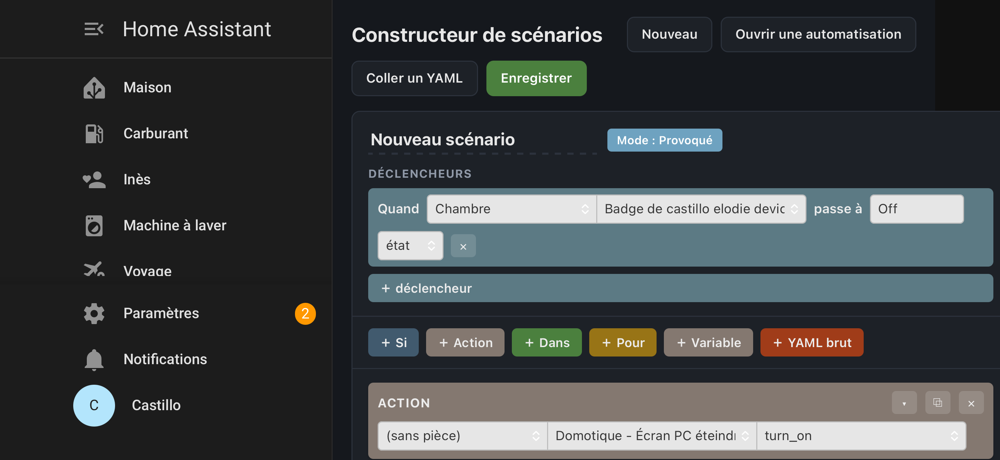

# 🧩 Constructeur de scénarios (façon Jeedom) pour Home Assistant

&nbsp;

> **Tu viens de quitter Jeedom pour Home Assistant et le constructeur de scénarios te manque ?**
> Ce plugin te le rend : les **mêmes blocs**, les **mêmes couleurs**, la **même façon de faire** —
> **mais il génère de vraies automatisations Home Assistant**, éditables en YAML.

Un panneau **« Scénarios »** s'ajoute dans la barre latérale. Tu construis visuellement, HA exécute du natif.

---

## Pourquoi ce plugin

La migration Jeedom → Home Assistant bute souvent sur un mur : les automatisations. On passe
d'un **constructeur visuel par blocs** (SI / ALORS / ACTION / #pièce‑équipement‑commande#) à du
YAML ou à un éditeur très différent. Résultat : on reste bloqué, ou on abandonne des scénarios
qui marchaient très bien.

Ce plugin **recrée l'expérience Jeedom par‑dessus Home Assistant**, sans rien verrouiller :
tout ce que tu construis devient une **automatisation HA standard**. Tu peux l'éditer ensuite en
YAML, la partager, la sauvegarder — c'est du Home Assistant pur. Le plugin n'est qu'un **assistant
d'écriture**, pas un moteur propriétaire.

## Fonctionnalités

| | |
|---|---|
| 🧱 **Blocs façon Jeedom** | SI / ALORS / SINON, ACTION, DANS (délai), POUR (boucle), VARIABLE, et **YAML brut** pour l'avancé |
| 🏠 **Sélection par pièce** | **Pièce → Équipement → Commande**, alimentée par tes zones, appareils et services HA |
| 🧮 **Conditions complètes** | expression libre avec **opérateurs** (`== != > < >= <= && \|\| !`) et une palette de **fonctions** (`time`, `value`, `trigger`, `average`, `tendance`, `variable`, `stateDuration`, `sun`…) |
| 🔁 **Ouvre et modifie l'existant** | importe n'importe quelle automatisation HA (ou colle son YAML) → elle devient des blocs éditables |
| 🛟 **Zéro perte** | ce qui n'a pas d'équivalent bloc (`wait_for_trigger`, `parallel`, `device`…) est gardé **verbatim** dans un bloc **« YAML brut »** et réinjecté à l'identique |
| 👁️ **YAML en direct** | le panneau affiche l'automatisation générée pendant que tu construis |
| 💾 **100 % natif** | aucune dépendance à l'exécution ; tes automatisations existantes ne sont jamais touchées |

## Installation

### Via HACS (recommandé)

1. Clique sur le bouton **« Open in HACS »** ci‑dessus — ou, manuellement : HACS → ⋮ →
   **Dépôts personnalisés** → `https://github.com/differentman38/jeedom-builder`, catégorie **Intégration**.
2. Installe **« Constructeur de scénarios (façon Jeedom) »**, puis **redémarre Home Assistant**.
3. **Réglages → Appareils et services → Ajouter une intégration →** *Constructeur de scénarios*
   (ou le bouton **« Ajouter l'intégration »** ci‑dessus). Aucun réglage à saisir.
4. L'entrée **« Scénarios »** apparaît dans la barre latérale. 🎉

### Manuellement

Copie `custom_components/jeedom_builder/` dans le dossier `config/custom_components/` de ton
Home Assistant, redémarre, puis ajoute l'intégration.

## Utilisation

- **Nouveau** : pose des blocs, choisis pièce → équipement → commande, « Enregistrer » → l'automatisation est créée.
- **Ouvrir une automatisation** : choisis‑en une dans la liste → elle se charge en blocs → modifie → « Enregistrer » (elle est réécrite en place).
- **Coller un YAML** : colle le YAML d'une automatisation → blocs éditables.

## Notes pour les migrants Jeedom

- Les **fonctions** sont proposées comme sur Jeedom ; les plus courantes sont traduites en template
  Jinja à la compilation. Une fonction exotique peut demander un petit ajustement du template généré
  (toujours éditable ensuite).
- Le bloc **« Code »** de Jeedom correspond ici à une **condition template** (`{{ … }}`) et au bloc
  **YAML brut** pour les actions avancées.
- Le sélecteur `#[pièce][équipement][commande]#` insère la référence de l'entité HA correspondante.

## Compatibilité

Home Assistant **2024.8** ou plus récent.

## Statut & feuille de route

Projet communautaire, early‑access (**v0.1.0**). Pistes : autocomplétion des valeurs d'état,
déclencheurs supplémentaires (numérique, cron), davantage de fonctions traduites, thème clair/sombre affiné.
Retours et PR bienvenus — l'objectif est d'aider la communauté Jeedom qui migre vers Home Assistant.

## Licence

[MIT](LICENSE).
